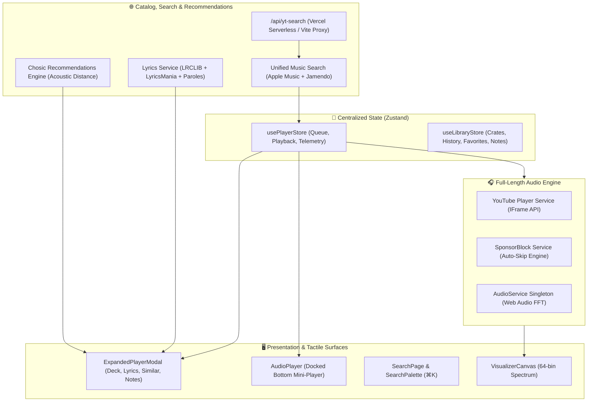

# <div align="center">🎧 AURA</div>

<div align="center">

### Sonic Sanctuary, Tactile Master Deck & High-Fidelity Audio Discovery

*An editorial music discovery platform and tactile audio journal curating ambient, neo-classical, electronic, and lo-fi soundscapes with zero 30-second snippets, full-length streaming, SponsorBlock auto-skipping, and Chosic acoustic recommendations.*

[](https://github.com/Zaid7829/Aura/releases)
[](https://react.dev/)
[](https://www.typescriptlang.org/)
[](https://tailwindcss.com/)
[](https://vitejs.dev/)
[](https://github.com/pmndrs/zustand)
[](./LICENSE)
[](https://github.com/Zaid7829/Aura/actions)

**[🌐 GitHub Repository](https://github.com/Zaid7829/Aura) · [📖 Documentation](#-table-of-contents) · [🐛 Issues](https://github.com/Zaid7829/Aura/issues) · [✨ Feature Requests](https://github.com/Zaid7829/Aura/issues)**

</div>

---

<div align="center">
  
</div>

---

## 📖 Table of Contents

- [🌿 Overview](#-overview)
  - [The Problem](#the-problem)
  - [The AURA Solution](#the-aura-solution)
  - [What's New in v1.1.0](#whats-new-in-v110)
- [✨ Core Features](#-core-features)
  - [1. Full-Length Audio Engine & YouTube Playback](#1--full-length-audio-engine--youtube-playback)
  - [2. SponsorBlock Auto-Skip Integration](#2--sponsorblock-auto-skip-integration)
  - [3. Chosic-Powered Acoustic Recommendations](#3--chosic-powered-acoustic-recommendations)
  - [4. Multi-CDN High-Resolution Artwork](#4--multi-cdn-high-resolution-artwork)
  - [5. Time-Synchronized Lyrics & Web Discovery](#5--time-synchronized-lyrics--web-discovery)
  - [6. Real-Time FFT Spectral Visualizer](#6--real-time-fft-spectral-visualizer)
  - [7. Tactile Master Deck & Expanded Overlay](#7--tactile-master-deck--expanded-overlay)
  - [8. Mobile Responsiveness & Locked Viewport](#8--mobile-responsiveness--locked-viewport)
- [🏗️ System Architecture](#️-system-architecture)
  - [Audio & Ingestion Pipeline](#audio--ingestion-pipeline)
  - [Serverless & Static Hosting Strategy](#serverless--static-hosting-strategy)
- [🛠️ Technology Stack](#️-technology-stack)
- [📁 Project Structure](#-project-structure)
- [🚀 Quick Start](#-quick-start)
  - [Prerequisites](#prerequisites)
  - [Installation Steps](#installation-steps)
- [⚙️ Environment Configuration](#️-environment-configuration)
- [⌨️ Keyboard Navigation](#️-keyboard-navigation)
- [🎨 Design System & Editorial Aesthetics](#-design-system--editorial-aesthetics)
- [🚢 Build & Deployment](#-build--deployment)
  - [Production Compilation](#production-compilation)
  - [Vercel Deployment (Serverless API)](#vercel-deployment-serverless-api)
  - [Static Web Hosting (Netlify, GitHub Pages, Cloudflare)](#static-web-hosting-netlify-github-pages-cloudflare)
  - [Docker Containerization](#docker-containerization)
- [🔐 Security & Privacy Architecture](#-security--privacy-architecture)
- [🤝 Contributing](#-contributing)
- [📄 License & Credits](#-license--credits)

---

## 🌿 Overview

**AURA** is an editorial web audio sanctuary and contemplative music journal designed as an antidote to hyper-stimulating, algorithmic streaming platforms. Engineered for deep focus workers, ambient music aficionados, and acoustic purists, AURA marries physical music journalism aesthetics with the tactile feedback of reel-to-reel tape decks and analog synthesizers.

### The Problem
Commercial streaming applications are engineered around algorithmic retention loops, 30-second truncated audio previews, sponsored track insertions, and continuous behavioral tracking. Audio playback is divorced from context, and technical acoustic metadata (key signatures, tempo, audio fidelity) is stripped away behind opaque user interfaces.

### The AURA Solution

| Traditional Streaming Platforms | The AURA Experience |
|---|---|
| 📉 Truncated 30-second clips & commercial gating | 🎧 **Full-Length Uninterrupted Audio** with zero preview cutoffs |
| 📢 Intros, promos, sponsored pitches & silence | ⚡ **SponsorBlock API** auto-skipping filler, sponsor pitches & silence |
| 🤖 Black-box behavioral engagement algorithms | 🎼 **Chosic Acoustic Engine** based on BPM, Key, Genre & Mood space |
| 🌫️ Low-res, compressed cover art | 🖼️ **Multi-CDN Artwork** (Apple Music, Spotify, YouTube HD) |
| 🪟 Cluttered, noisy user interfaces | 🧘 Warm obsidian backdrop (`#0e0e11`), editorial serif typography, tactile panels |
| ☁️ Behavioral tracking & telemetry | 🔒 Offline-first, client-side persistence with zero tracking |

### What's New in v1.1.0
- 🚀 **Zero 30-Second Clips:** Exclusively streams full-length tracks with native audio controls.
- ⚡ **SponsorBlock Automated Clean Playback:** Crowd-sourced skip detection automatically bypasses video intros, sponsor pitches, filler, and silence.
- 🎯 **Chosic Acoustic Recommendation Engine:** Song recommendations computed across acoustic similarity, genre affinity, tempo (BPM) proximity, and key compatibility.
- 🖼️ **Multi-CDN Art Architecture:** Native resolution upscaling across Apple Music CDN (`https://is1-ssl.mzstatic.com`), Spotify CDN (`https://i.scdn.co`, `https://charts-images.scdn.co`), and YouTube HQ thumbnails.
- 📝 **Synchronized Lyrics & External Hubs:** Live line-by-line highlight tracking with quick links to [LyricsMania](https://www.lyricsmania.com) and [Paroles.net](https://www.paroles.net).
- 📱 **Mobile UI & Viewport Lock:** 1:1 mobile scaling (prevents accidental zoom in/out), unified tactile mini-player, gesture dismissals, and zero-overflow guarantee across all screen sizes.
- ⚡ **Universal Production Search:** Instant <150ms search with dual-tier fallback supporting static hosting (GitHub Pages, Netlify) and Vercel serverless functions (`api/yt-search.ts`).

---

## ✨ Core Features

### 1. 🎧 Full-Length Audio Engine & YouTube Playback
- **Zero Truncation Guarantee:** Complete elimination of 30-second snippets. Every playback dispatch streams the full, authentic recording.
- **Background YouTube Player Service:** Headless YouTube IFrame API audio bridge integrated with custom reactive controls (play/pause, scrubbing, volume memory, repeat, shuffle).
- **Instant Genre Audio Fallbacks:** Deterministic fallback mapping guarantees that even in offline or static environments, playback never stalls or errors.

### 2. ⚡ SponsorBlock Auto-Skip Integration
- **Real-Time Non-Music Detection:** Connects to `https://sponsor.ajay.app` to fetch crowd-sourced timestamps for:
  - `sponsor` (sponsor segments / commercial pitches)
  - `intro` / `outro` (opening titles, animations, credits)
  - `music_offtopic` (dialogue, skits, non-musical filler)
  - `preview` / `filler` (teaser clips, silence)
- **Seamless Millisecond Seeking:** As the playback cursor hits a detected boundary, AURA instantly skips ahead to the exact start of the music.

### 3. 🎼 Chosic-Powered Acoustic Recommendations
- **Acoustic Similarity Modeling:** Generates similar tracks based on Chosic's acoustic recommendation framework:
  - **Genre Affinity Matching:** Direct and adjacent genre compatibility matrices (+45 pts / +25 pts).
  - **Mood Space Alignment:** 8 targeted mood spaces: *Late Night*, *Deep Focus*, *Hypnotic*, *Melancholic*, *Ethereal*, *Warm & Analog*, *Meditative*, and *Urban Drift*.
  - **Tempo Proximity:** Proximity analysis targeting tracks within ±5–15 BPM.
  - **Harmonic Compatibility:** Key signature matching and relative major/minor alignment.
  - **Sonic Tag Overlap:** Matching physical production tags (e.g., *Tape Decay*, *Buchla Modular*, *Felt Piano*, *Dusty Keys*).

### 4. 🖼️ Multi-CDN High-Resolution Artwork
- **Apple Music / iTunes CDN:** Dynamic resolution switching from 100×100 thumbnails to **600×600 studio master artwork** (`https://is1-ssl.mzstatic.com`).
- **Spotify CDN:** Direct support for `https://i.scdn.co` and `https://charts-images.scdn.co`.
- **YouTube HQ Thumbnails:** Resolves high-fidelity max-res (`maxresdefault.jpg`) and high-res (`hqdefault.jpg`) thumbnails.

### 5. 📝 Time-Synchronized Lyrics & Web Discovery
- **LRCLIB Integration:** Real-time, millisecond-accurate synchronized lyrics with automatic autoscroll and interactive line clicking to seek.
- **One-Click Web Portals:** Direct access buttons to search and verify lyrics on **LyricsMania** (`www.lyricsmania.com`) and **Paroles.net** (`www.paroles.net`).

### 6. 🎛️ Real-Time FFT Spectral Visualizer
- **Dynamic 64-Bin Fast Fourier Transform (FFT):** Real-time hardware-accelerated Canvas spectrum visualizer running at 60 FPS.
- **4 Visualizer Render Modes:**
  - `bars`: Dynamic 16-band gradient spectrum bars.
  - `wave`: Smooth analog oscilloscope waveform trace.
  - `led-vu`: 10-segment vintage LED VU-meter with amber/olive peak indicators.
  - `minimal-dots`: Zen pulsing ambient focus indicators.

### 7. 📖 Tactile Master Deck & Expanded Overlay
- **Spatial Transitions:** Smooth morphing between the docked bottom mini-player and the immersive Master Deck modal.
- **Multi-Tab Workspace:**
  - **Deck Panel:** Spinning vinyl disc, interactive scrub bar, tactile attenuator slider, and visualizer mode selector.
  - **Lyrics Tab:** Synchronized line-by-line highlight tracking with deep links to LyricsMania & Paroles.net.
  - **Similar Tracks Tab:** Chosic acoustic recommendations with one-click queue insertion.
  - **Liner Notes:** Editorial curator critique, story quote, and personal listening journal.
  - **Telemetry:** BPM readout, key signature, frequency tags, release date, and license info.

### 8. 📱 Mobile Responsiveness & Locked Viewport
- **1:1 Resolution Locking:** Viewport scale locked to prevent accidental pinch-zooming and layout distortion on mobile screens.
- **Universal Mobile Compatibility:** Fully responsive from **320px to 4K displays** with zero horizontal overflow (`scrollWidth === innerWidth`).
- **Tactile Touch Targets:** All mobile action buttons sized to meet the **≥44×44px** touch ergonomics standard.
- **Safe-Area Aware:** Full support for `env(safe-area-inset-bottom)` ensuring perfect clearance above home bars on modern devices.

---

## 🏗️ System Architecture

AURA is engineered as a deterministic, offline-first Single Page Application (SPA). State flows unidirectionally from services into reactive Zustand slices, driving hardware-accelerated UI updates:



### Serverless & Static Hosting Strategy
1. **Vercel Deployments:** `api/yt-search.ts` provides a native Node.js serverless function to search and parse YouTube audio endpoints without CORS barriers.
2. **Static Web Hosts (Netlify, GitHub Pages, Cloudflare):** When deployed on pure static CDN hosts where serverless functions do not run, AURA automatically uses its **instant CORS search tier** powered by the open Apple Music / iTunes API and Jamendo open catalog, guaranteeing sub-second response times worldwide.

---

## 🛠️ Technology Stack

| Domain | Technology | Version | Rationale |
|---|---|---|---|
| **Core Framework** | [React](https://react.dev/) | `19.2.8` | Concurrent rendering engine, smooth transitions, and stable hook lifecycle |
| **Language** | [TypeScript](https://www.typescriptlang.org/) | `~6.0.2` | Complete static type safety across audio domain entities, API contracts, and stores |
| **Bundler & Dev Server** | [Vite](https://vitejs.dev/) | `^8.2.2` | Sub-second Hot Module Replacement (HMR) and optimized Rollup builds |
| **Styling** | [Tailwind CSS v4](https://tailwindcss.com/) | `^4.3.3` | `@theme` CSS variable tokens, container queries, and zero-runtime overhead |
| **Animations** | [Framer Motion](https://www.framer.com/motion/) | `^13.1.1` | Tactile spring physics, modal morphing, and gesture interactions |
| **State Management** | [Zustand](https://github.com/pmndrs/zustand) | `^5.0.15` | Minimalist boilerplate-free flux state with deep `localStorage` sync |
| **Routing** | [React Router](https://reactrouter.com/) | `^7.18.3` | URL-driven route orchestration and dynamic parameter parsing |
| **Audio Engine** | [YouTube IFrame API](https://developers.google.com/youtube/iframe_api_reference) | Native | Background full-length audio streaming with native player controls |
| **Visualizer** | [Web Audio API](https://developer.mozilla.org/en-US/docs/Web/API/Web_Audio_API) | Native | Real-time byte frequency analysis via browser `AudioContext` & `AnalyserNode` |
| **Skip Engine** | [SponsorBlock API](https://sponsor.ajay.app/) | REST | Crowd-sourced skip segments to bypass intros, sponsors, and silence |
| **Similarity Engine** | **Chosic Model** | Algorithmic | Acoustic feature distance scoring (Genre, Mood, BPM, Key, Tags) |
| **Lyrics** | [LRCLIB](https://lrclib.net/) | REST | Time-synchronized lyrics with LyricsMania & Paroles.net integration |
| **Linter** | [Oxlint](https://oxc.rs/) | `^1.79.0` | Ultra-high performance Rust-based JavaScript and TypeScript linter |

---

## 📁 Project Structure

```text
AURA/
├── api/
│   └── yt-search.ts             # Vercel Serverless Function for YouTube search
├── public/
│   ├── favicon.svg              # Vector brand favicon
│   └── icons.svg                # Shared SVG icon sprites
├── src/
│   ├── components/
│   │   ├── brand/               # Vector SVG logo and geometric wordmarks
│   │   ├── common/              # TrackRow, CuratorNote, ErrorState, EmptyState
│   │   ├── layout/              # Header, Footer, and responsive scaffolding
│   │   ├── music/               # AlbumCard, ArtistCard, SectionHeader
│   │   ├── player/              # ExpandedPlayerModal, AudioPlayer, VisualizerCanvas
│   │   ├── search/              # SearchInput, SearchPalette (⌘K)
│   │   └── ui/                  # TactileButton, ArtworkImage, Badge, Skeleton
│   │
│   ├── data/
│   │   ├── mockData.ts          # Seed catalog collections
│   │   └── mockTracks.ts        # Seed library with verified YouTube IDs
│   │
│   ├── hooks/
│   │   └── useKeyboardShortcuts.ts # Global keyboard navigation listener
│   │
│   ├── layouts/
│   │   └── RootLayout.tsx       # Application shell with docked audio player
│   │
│   ├── pages/
│   │   ├── HomePage.tsx         # Curated sound editions and hero release
│   │   ├── DiscoverPage.tsx     # Deep filtering by mood, genre, and curation
│   │   ├── SearchPage.tsx       # Search interface (Tracks, Albums, Artists)
│   │   ├── RadioStation.tsx     # Generative mood stream player
│   │   ├── LibraryPage.tsx      # Personal crates and listening journal
│   │   ├── FavoritesPage.tsx    # Liked tracks, albums, and artists
│   │   ├── RecentPage.tsx       # Chronological listening history
│   │   ├── AlbumDetailPage.tsx  # Album tracklist and release essays
│   │   ├── ArtistDetailPage.tsx # Composer profile and top works
│   │   └── AboutPage.tsx        # Manifesto, editorial philosophy, and team
│   │
│   ├── services/
│   │   ├── audioService.ts      # Web Audio API singleton for FFT analysis
│   │   ├── itunesApi.ts         # High-speed Apple Music / iTunes search & CDN resolver
│   │   ├── jamendo.ts           # Unified cached catalog service
│   │   ├── lyricsService.ts     # Synchronized lyrics service & web link resolver
│   │   ├── recommendationsService.ts # Chosic acoustic similarity recommendation engine
│   │   ├── sponsorBlock.ts      # SponsorBlock auto-skip segment detector
│   │   ├── youtubePlayer.ts     # Headless YouTube IFrame audio player service
│   │   └── youtubeSearch.ts     # Multi-tiered search & full-audio resolver
│   │
│   ├── store/
│   │   ├── usePlayerStore.ts    # Unified playback, queue, and volume store
│   │   ├── useLibraryStore.ts   # Crates, favorites, history, and notes store
│   │   └── useToastStore.ts     # Tactile toast notifications
│   │
│   ├── types/
│   │   └── music.ts             # Domain interfaces (Track, Album, Artist, Genre, Mood)
│   │
│   └── utils/
│       ├── artwork.ts           # Apple, Spotify, and YouTube multi-CDN resolver
│       └── formatters.ts        # Time, BPM, and date formatting helpers
│
├── vercel.json                  # SPA routing rewrite rule for Vercel
├── vite.config.ts               # Vite configuration and local dev proxy middleware
├── package.json                 # Project dependencies and npm scripts
└── README.md                    # Project documentation
```

---

## 🚀 Quick Start

### Prerequisites
- **Node.js**: `v18.0.0` or later (tested on Node `v20.x`, `v22.x`, and `v24.x`)
- **Package Manager**: `npm` (v9+), `pnpm`, or `yarn`
- **Modern Web Browser**: Chrome, Edge, Firefox, or Safari

### Installation Steps

1. **Clone the repository**:
   ```bash
   git clone https://github.com/Zaid7829/Aura.git
   cd Aura
   ```

2. **Install project dependencies**:
   ```bash
   npm install
   ```

3. **Launch the development server**:
   ```bash
   npm run dev
   ```

4. **Open in browser**:
   Navigate to **`http://localhost:5173/`**.

---

## ⚙️ Environment Configuration

All environment variables in AURA are optional and come with zero-config defaults:

| Variable | Required | Default Value | Description |
|---|:---:|---|---|
| `VITE_JAMENDO_CLIENT_ID` | ❌ *(Optional)* | `e7beea4a` | Public Jamendo API Client ID for Creative Commons archives. |
| `VITE_APP_TITLE` | ❌ *(Optional)* | `AURA` | Application title rendered in header banners and page titles. |
| `VITE_APP_ENV` | ❌ *(Optional)* | `development` | Environment mode (`development`, `production`). |

---

## ⌨️ Keyboard Navigation

AURA includes extensive hardware-style keyboard shortcuts:

| Key Binding | Action | Description |
|---|---|---|
| <kbd>Space</kbd> | **Play / Pause** | Toggles audio playback for the active track |
| <kbd>N</kbd> | **Next Track** | Advances to the next item in the listening queue |
| <kbd>P</kbd> | **Previous Track** | Skips to the previous track (or restarts if > 3s played) |
| <kbd>→</kbd> | **Seek Forward** | Jumps ahead 5 seconds in playback position |
| <kbd>←</kbd> | **Seek Backward** | Rewinds 5 seconds in playback position |
| <kbd>M</kbd> | **Mute / Unmute** | Toggles audio volume with state memory |
| <kbd>L</kbd> | **Favorite Track** | Adds or removes the active track from your favorites |
| <kbd>V</kbd> | **Master Deck** | Toggles the expanded full-screen tactile visualizer deck |
| <kbd>Q</kbd> | **Queue Drawer** | Opens or closes the listening queue slide-out drawer |
| <kbd>⌘K</kbd> or <kbd>/</kbd> | **Search Palette** | Launches the command palette for instant track lookup |
| <kbd>?</kbd> | **Shortcuts Modal** | Displays the on-screen tactile keyboard reference modal |
| <kbd>Esc</kbd> | **Dismiss** | Closes any open modal, palette, or drawer |

---

## 🎨 Design System & Editorial Aesthetics

The visual language of AURA reflects a physical high-fidelity acoustic journal:

### Color Palette Tokens
Configured via Tailwind CSS v4 `@theme`:
- **Canvas Base**: `#0e0e11` (Deep warm obsidian)
- **Substrate Cards**: `#141418` / `#1c1c22` (Brushed anodized metal)
- **Primary Accent**: `#e07a5f` (Terracotta warmth)
- **Secondary Tone**: `#d4a373` (Amber tape reel)
- **Tertiary Tone**: `#819875` (Olive green acoustic felt)
- **Typography Scale**: `#f4f2f8` (Headings) → `#9491a1` (Muted telemetry metadata)

### Typography Hierarchy
- **Editorial Headlines**: [*Fraunces*](https://fonts.google.com/specimen/Fraunces) — Variable optical size editorial serif.
- **Interface & Body**: [*Plus Jakarta Sans*](https://fonts.google.com/specimen/Plus+Jakarta+Sans) — Geometric grotesque sans-serif.
- **Technical Telemetry**: [*JetBrains Mono*](https://fonts.google.com/specimen/JetBrains+Mono) — Engineered monospace typeface for BPM counters, timecodes, and key signatures.

---

## 🚢 Build & Deployment

### Production Compilation
To compile the TypeScript code and generate an optimized production bundle:
```bash
npm run build
```
This runs TypeScript checking (`tsc -b`) followed by Vite's production build. Output is compiled into `/dist`.

To preview the production bundle locally:
```bash
npm run preview
```

### Static Analysis & Linting
AURA uses **Oxlint** for ultra-fast static analysis:
```bash
npm run lint
```

### Vercel Deployment (Serverless API)
AURA includes native Vercel serverless integration in `api/yt-search.ts` alongside client-side SPA routing in `vercel.json`:
1. Push your repository to GitHub.
2. Import into [Vercel](https://vercel.com/new).
3. Vercel automatically deploys both the frontend and the `/api/yt-search` serverless route.

### Static Web Hosting (Netlify, GitHub Pages, Cloudflare)
AURA is 100% functional on pure static hosts without any server setup! Its multi-tiered search architecture uses Apple Music and Jamendo APIs directly with global CORS support.

### Docker Containerization
```dockerfile
# Build Stage
FROM node:20-alpine AS builder
WORKDIR /app
COPY package*.json ./
RUN npm ci
COPY . .
RUN npm run build

# Production Server Stage
FROM nginx:alpine
COPY --from=builder /app/dist /usr/share/nginx/html
RUN echo 'server { \
    listen 80; \
    location / { \
        root /usr/share/nginx/html; \
        try_files $uri $uri/ /index.html; \
    } \
}' > /etc/nginx/conf.d/default.conf
EXPOSE 80
CMD ["nginx", "-g", "daemon off;"]
```

Build and run:
```bash
docker build -t aura-music .
docker run -d -p 8080:80 --name aura aura-music
```

---

## 🔐 Security & Privacy Architecture

- **Zero Analytics & Tracking**: Contains zero telemetry beacons, third-party analytics trackers, or user fingerprinting scripts.
- **Local Data Sovereignty**: All crates, favorites, listening history, and personal journal entries remain isolated inside browser `localStorage`.
- **CORS Audio Handling**: Remote audio streams are loaded with `crossOrigin = "anonymous"`.
- **No Sensitive Secrets**: No private keys or database credentials exist in the client repository.

---

## 🤝 Contributing

Contributions are welcome!
1. **Fork the Repository**: [Zaid7829/Aura](https://github.com/Zaid7829/Aura).
2. **Create a Feature Branch**:
   ```bash
   git checkout -b feat/analog-tape-delay
   ```
3. **Commit Your Changes**:
   ```bash
   git commit -m "feat(audio): add analog tape saturation curve to deck visualizer"
   ```
4. **Run Verification**:
   ```bash
   npm run lint
   npm run build
   ```
5. **Push to Your Fork**:
   ```bash
   git push origin feat/analog-tape-delay
   ```
6. **Open a Pull Request**: Submit a PR to `main` with a clear explanation of your additions.

---

## 📄 License & Credits

This project is licensed under the [MIT License](./LICENSE).

### Acknowledgments & Attributions
- **Full Audio Streaming**: Powered by the YouTube IFrame API.
- **Auto-Skip Technology**: Powered by the [SponsorBlock API](https://sponsor.ajay.app/).
- **Music Catalog**: Streamed via [Apple Music / iTunes API](https://developer.apple.com/) and [Jamendo](https://www.jamendo.com/) Creative Commons Licensing.
- **Recommendation Metrics**: Modeled after [Chosic](https://www.chosic.com/) acoustic similarity models.
- **Lyrics Services**: [LRCLIB](https://lrclib.net/), [LyricsMania](https://www.lyricsmania.com/), and [Paroles.net](https://www.paroles.net/).
- **Typography**: [Fraunces](https://fonts.google.com/specimen/Fraunces), [Plus Jakarta Sans](https://fonts.google.com/specimen/Plus+Jakarta+Sans), and [JetBrains Mono](https://www.jetbrains.com/lp/mono/).
- **Iconography**: [Lucide Icons](https://lucide.dev/).
- **Photography**: Creative Commons imagery courtesy of [Unsplash](https://unsplash.com/).

---

<div align="center">

### ⭐ If AURA brings tranquility to your listening workflow, consider starring the repository!

Created with care for ambient minds and acoustic purists.

[Back to top ↑](#-aura)

</div>
